# VINS-Mono-Inno for ROS 2

VINS-Mono-Inno is a ROS 2 port and UAV-oriented fork of
[VINS-Mono](https://github.com/HKUST-Aerial-Robotics/VINS-Mono) by the HKUST
Aerial Robotics Group. It provides monocular visual-inertial odometry, feature
tracking, optional loop closure, and pose-graph optimization.

This repository uses ROS 2 packages, `ament_cmake`, Python launch files, and
`colcon`. The old ROS 1 `catkin_make`, `roslaunch`, and `rosbag play` commands do
not apply to this version.

The current migration is developed and tested on Ubuntu 24.04 with ROS 2 Jazzy.

## Packages

- `camera_model` — pinhole and omnidirectional camera models.
- `feature_tracker` — image decoding, feature detection, optical flow, masks,
  and debug image publication.
- `vins_estimator` — sliding-window visual-inertial estimator.
- `pose_graph` — loop detection and pose-graph optimization.
- `vins_bringup` — ROS 2 launch files and installed configuration files.
- `benchmark_publisher` — optional benchmark visualization support.

The repository also contains UAV-specific additions such as adaptive feature
tracking, optional bidirectional optical flow, IMU filtering, ZUPT, temporal
offset estimation, and MAVROS integration.

## Requirements

Install ROS 2 Jazzy and the required ROS packages:

```bash
sudo apt update
sudo apt install \
  ros-jazzy-cv-bridge \
  ros-jazzy-image-transport \
  ros-jazzy-compressed-image-transport \
  ros-jazzy-rviz2 \
  ros-jazzy-tf2-ros
```

The project also requires OpenCV, Eigen, Boost, and Ceres Solver. On Ubuntu,
the development packages can normally be installed with:

```bash
sudo apt install libopencv-dev libeigen3-dev libboost-all-dev libceres-dev
```

## Build

Place the repository inside a ROS 2 workspace, then build it with `colcon`:

```bash
mkdir -p ~/ros2_ws/src
cd ~/ros2_ws/src
git clone https://github.com/Innopolis-UAV-Team/VINS-Mono-inno.git

cd ~/ros2_ws
source /opt/ros/jazzy/setup.bash
colcon build --symlink-install
source install/setup.bash
```

If the repository is already located in `~/ros2_ws/src`, only the last four
commands are needed. Add the ROS and workspace setup files to `.bashrc` if you
want new terminals to source them automatically.

## Run the Innospector fisheye bag configuration

The launch file `innospector_cam.launch.py` starts:

- `feature_tracker`;
- `vins_estimator`;
- `pose_graph`.

Its parameters are stored in
`config/fisheye_bag/fisheye_bag_config.yaml`. The supplied configuration expects:

- compressed camera images on `/image_raw/compressed`;
- IMU messages on `/mavros/imu/data`.

The YAML uses the image-transport base topic `/image_raw` together with
`image_input_format: "compressed"`. Do not change the base topic to
`/image_raw/compressed` when compressed transport is enabled.

Terminal 1 — start VINS:

```bash
cd ~/ros2_ws
source /opt/ros/jazzy/setup.bash
source install/setup.bash
ros2 launch vins_bringup innospector_cam.launch.py
```

Terminal 2 — play the ROS 2 bag:

```bash
cd ~/ros2_ws
source /opt/ros/jazzy/setup.bash
source install/setup.bash
ros2 bag play /path/to/bag
```

Only the required bag topics may be played:

```bash
ros2 bag play /path/to/bag \
  --topics /image_raw/compressed /mavros/imu/data
```

Terminal 3 — start the supplied RViz configuration:

```bash
source ~/ros2_ws/install/setup.bash
ros2 launch vins_bringup vins_rviz.launch.py
```

RViz is recommended for viewing the tracked-feature image. Some versions of
`rqt_image_view` perform poorly with large, high-rate images.

## Other launch configurations

All supported ROS 2 launch files are owned by `vins_bringup`. The
`vins_estimator` package contains the estimator executable and algorithm; it is
not a duplicate bringup package and no longer contains legacy ROS 1 XML launch
files. Always launch a complete configuration with:

```bash
ros2 launch vins_bringup <name>.launch.py
```

For the thermal camera configuration, start the estimator pipeline with:

```bash
cd ~/ros2_ws
source /opt/ros/jazzy/setup.bash
source install/setup.bash
ros2 launch vins_bringup termal_cam.launch.py
```

Then start RViz in another terminal:

```bash
source ~/ros2_ws/install/setup.bash
ros2 launch vins_bringup vins_rviz.launch.py
```

The thermal launch reads `config/termal_cam_config.yaml` and starts
`feature_tracker`, `vins_estimator`, and `pose_graph` together.

```bash
ros2 launch vins_bringup euroc.launch.py
ros2 launch vins_bringup euroc_no_extrinsic_param.launch.py
ros2 launch vins_bringup realsense_color.launch.py
ros2 launch vins_bringup realsense_fisheye.launch.py
ros2 launch vins_bringup usb_cam.launch.py
ros2 launch vins_bringup termal_cam.launch.py
ros2 launch vins_bringup 3dm.launch.py
```

Review the corresponding file under `config/` before using a launch file. Topic
names, camera calibration, camera-to-IMU extrinsics, IMU noise parameters, and
time synchronization must match the actual sensor system.

## Verify the pipeline

Check that the source topics are active:

```bash
ros2 topic hz /image_raw/compressed
ros2 topic hz /mavros/imu/data
```

Check each processing stage:

```bash
ros2 topic hz /feature_tracker/feature
ros2 topic hz /feature_tracker/feature_img
ros2 topic hz /vins_estimator/odometry
ros2 topic hz /vins_estimator/path
```

Inspect endpoint types and QoS when a publisher and subscriber do not connect:

```bash
ros2 topic info -v /image_raw/compressed
ros2 topic info -v /feature_tracker/feature
```

Expected types include:

- `/image_raw/compressed`: `sensor_msgs/msg/CompressedImage`;
- `/feature_tracker/feature`: `sensor_msgs/msg/PointCloud`;
- `/feature_tracker/feature_img`: `sensor_msgs/msg/Image`;
- `/vins_estimator/odometry`: `nav_msgs/msg/Odometry`.

## Camera masks and image formats

`feature_tracker` supports ROS 2 raw and compressed image transport. Select the
transport in the camera configuration:

```yaml
image_topic: "/image_raw"
image_input_format: "compressed"  # use "raw" for sensor_msgs/msg/Image
```

A custom feature mask can restrict tracking to valid image pixels:

```yaml
fisheye: 1
fisheye_mask: "config/mask.jpg"
```

The mask must have the same width and height as the configured camera. White
pixels enable feature detection and black pixels exclude an area. This mask
does not select or replace the camera projection model.

## Feature tracker parameters

These parameters are set in the camera YAML configuration file. They control
corner detection and optical-flow tracking. These are not BRIEF descriptor
parameters: BRIEF is used separately by the `pose_graph` module for loop
closure.

The ranges below are practical starting ranges for a 1280×1024 image at
~30 FPS, not hard limits enforced by code. For other resolutions, `max_cnt`
should scale roughly with frame area and `min_dist` with linear size. The final
choice should be guided by CPU load and `[AUTO_TUNE]` output: aim for `fill`
above 90% and stable `retention` above 70–80% on segments without heavy motion
blur.

| Parameter | Purpose and effect | Practical range / starting point |
|---|---|---|
| `max_cnt` | Target maximum number of tracked points per frame. Existing tracks are kept with priority and distributed evenly across the image; free slots are filled with new points. A higher value generally improves robustness but increases CPU load, RANSAC cost, and optimizer load. This is an upper bound, not a guarantee of the actual point count. | For 1280×1024: `150–800`; start at `250–400`. Above `500–600` only makes sense with sufficient CPU and texture. |
| `min_dist` | Minimum spatial distance between selected points, in pixels. A larger value gives sparser, more uniform coverage; too large prevents reaching `max_cnt`. A small value allows more points but increases the risk of clusters on a single textured region. | `8–40 px`; start at `15–25 px`. For `max_cnt: 250`, `10–25 px` is acceptable. |
| `freq` | Target rate for feature set publication and replenishment, in Hz. Incoming images are still used for optical flow, but RANSAC, new-point detection, and publication run only on selected frames. `0` in the config is replaced with `100`. | `10–30 Hz`; start at `20–25 Hz`. Generally do not set above the actual camera rate. |
| `F_threshold` | RANSAC error threshold for the fundamental-matrix check, in pixels on the virtual undistorted image. A lower value rejects outliers more aggressively but may drop good tracks under noise or blur. A higher value keeps more points, including potential outliers. | `0.5–2.0 px`; start at `1.0 px`. For sharp images try `0.7–1.0`; for noisy/blurry ones `1.0–1.5`. |
| `gftt_quality_level` | Relative quality threshold for Shi–Tomasi `goodFeaturesToTrack`; mathematically valid range `(0, 1]`. Used for new points only when `use_advanced_flow: 0`. Lower = more weak corners; higher = fewer but usually better. | Working range `0.001–0.03`; start at `0.005–0.01`. Values above `0.05` often yield too few points. |
| `fast_threshold` | AGAST threshold for new points. Used only when `use_advanced_flow: 1`. Lower = more candidates including weak and noisy ones; higher = fewer candidates with stronger contrast. | `7–40`; start at `15–20`. For low-contrast/thermal images often `7–15`; for noisy ones `20–30`. |
| `enable_feature_auto_tuning` | Enables (`1`) periodic adjustment of the active detector threshold. For AGAST it adjusts `fast_threshold`; for Shi–Tomasi it adjusts `gftt_quality_level`. `max_cnt`, `min_dist`, `F_threshold`, and optical-flow parameters are not changed automatically. | `0` or `1` only; start with `0` for manual baseline tuning, then try `1` on the full dataset. |
| `feature_auto_tune_interval` | Auto-tune interval in seconds; minimum allowed value is `0.5`. Fill and retention statistics are accumulated between updates. Active only when auto-tuning is enabled. | `2–30 s`; start at `5–10 s`. Below `2 s` may cause unnecessary threshold oscillation. |
| `feature_auto_tune_log` | When `1`, prints an `[AUTO_TUNE]` line to the ROS console and log after each interval. It reports fill, retention, candidate count, and current thresholds. Does not enable auto-tuning itself. | `0` or `1` only; recommended `1` during tuning. |
| `fast_threshold_min`, `fast_threshold_max` | Lower and upper bounds within which auto-tuning may change the AGAST threshold. When auto-tuning is off, the bounds do not modify `fast_threshold` except for initial clamping at config load. | General safe range `3–60`; starting pair `7` and `40–45`. The gap between bounds should be at least `10`. |
| `gftt_quality_min`, `gftt_quality_max` | Lower and upper bounds for automatic adjustment of `gftt_quality_level` (Shi–Tomasi). When `use_advanced_flow: 1`, this range is not used for new-point selection. | Minimum `0.0005–0.005`, maximum `0.02–0.10`; starting pair `0.001` and `0.03–0.05`. |
| `use_bidirectional_flow` | When `1`, runs a reverse LK pass after the forward flow and rejects points with poor forward-backward consistency. Improves robustness but nearly doubles optical-flow cost. Only implemented in the `use_advanced_flow: 1` branch. | `0` or `1` only; `1` for quality, `0` when CPU is limited. |
| `use_advanced_flow` | Selects the tracker mode. `1`: AGAST, spatial selection, subpixel refinement of a subset, and extended LK settings. `0`: Shi–Tomasi and basic LK. This parameter also determines which threshold auto-tuning adjusts. | `0` or `1` only; use `1` for the current uniform AGAST-based selection. |
| `show_track` | When `1`, publishes an image with track visualization on `/feature_tracker/feature_img`. Does not disable publication of the feature points themselves on `/feature_tracker/feature`. Visualization adds CPU and ROS bandwidth cost. | `0` or `1` only; `1` during tuning, `0` for minimal overhead. |
| `equalize` | When `1`, applies CLAHE to each grayscale frame before tracking and detection. Helps with low or uneven lighting but may amplify noise and adds computational cost. | `0` or `1` only; for dark/thermal cameras start with `1`; with good stable lighting compare against `0`. |
| `fisheye` | When `1`, enables applying `fisheye_mask` to point selection. This parameter does not select the camera model or enable fisheye distortion correction; the model is set separately via `model_type`. | `0` or `1` only; `1` if a mask is actually needed and matches the frame. |
| `fisheye_mask` | Path to a single-channel mask matching the image size. White pixels allow features, black pixels exclude regions. Relative paths are resolved against the `vins_bringup` package share directory; absolute paths are used as-is. | Non-numeric. Size must match `image_width × image_height`; the white usable area should be large enough to reach `max_cnt`. |

Example manual AGAST configuration:

```yaml
max_cnt: 250
min_dist: 10
fast_threshold: 20
use_advanced_flow: 1
enable_feature_auto_tuning: 0
```

In this mode `gftt_quality_level`, `gftt_quality_min`, and `gftt_quality_max`
do not affect new-point detection. `feature_auto_tune_interval` and
`feature_auto_tune_log` take effect only after setting
`enable_feature_auto_tuning: 1`.

### `use_advanced_flow: 1` pipeline (AGAST + LK)

When `use_advanced_flow: 1` is set, the feature tracker uses an enhanced
processing pipeline instead of the basic Shi-Tomasi path. The full per-frame
pipeline is described below.

```mermaid
flowchart TD
    A["Input: new frame<br/>+ timestamp"] --> B{"EQUALIZE?"}
    B -->|Yes| C["CLAHE<br/>clipLimit=3.0, grid=8x8"]
    B -->|No| D["Use as-is"]
    C --> E["forw_img = frame"]
    D --> E

    E --> F{"Existing tracks<br/>from prev frame?"}
    F -->|No| G["Skip LK"]
    F -->|Yes| H["LK optical flow<br/>cur_img → forw_img<br/>window 21x21, pyr=3<br/>TermCriteria COUNT+EPS 40/0.001"]

    H --> I{"use_bidirectional_flow?"}
    I -->|Yes| J["Reverse LK<br/>forw_img → cur_img<br/>reject if dist² > 0.5 px²"]
    I -->|No| K["Skip"]
    J --> L["Border check<br/>reject edge points"]
    K --> L

    L --> M["reduceVector<br/>remove rejected"]
    M --> N{"ENABLE_VELOCITY_CHECK?"}
    N -->|Yes| O["Estimate velocity<br/>from optical flow"]
    O --> P{"vel > threshold?"}
    P -->|Yes| Q["adaptive_max_cnt += boost"]
    P -->|No| R["adaptive_max_cnt = MAX_CNT"]
    N -->|No| R

    R --> S["track_cnt++ for all"]
    S --> T{"PUB_THIS_FRAME?<br/>freq throttle"}
    T -->|No| Z["End of frame"]
    T -->|Yes| U["rejectWithF()<br/>RANSAC F-matrix<br/>F_THRESHOLD, conf=0.99<br/>on undistorted points"]

    U --> V["setMask()<br/>fisheye_mask + MIN_DIST<br/>spatial bucketing<br/>round-robin selection"]
    V --> W["Detect new points"]
    W --> X["AGAST<br/>threshold = fast_threshold"]
    X --> Y["Grid filter<br/>cells MIN_DIST x MIN_DIST<br/>strongest response per cell"]
    Y --> AA["Spatial bucketing<br/>round-robin across buckets<br/>until n_max_cnt filled"]
    AA --> BB["cornerSubPix<br/>top-50 points<br/>window 5x5, EPS+COUNT 40/0.001"]
    BB --> CC["addPoints()<br/>new points → forw_pts"]
    CC --> DD["updateAutoTuning()<br/>fill/retention stats<br/>adjust fast_threshold"]
    DD --> EE["undistortedPoints()<br/>liftProjective → normalized<br/>compute pts_velocity"]
    EE --> Z
```



#### Step-by-step description

1. **Preprocessing** — optional CLAHE equalization (`equalize: 1`) for dark
   or unevenly lit scenes. Applied before tracking and detection.

2. **LK optical flow** — `cv::calcOpticalFlowPyrLK` tracks points from the
   previous frame into the current one. Parameters:
   - Window: 21×21 pixels
   - Pyramid levels: 3
   - Termination criteria: 40 iterations or ε = 0.001

3. **Bidirectional check** (optional, `use_bidirectional_flow: 1`) — reverse
   LK flow from the current frame back to the previous one. A point is rejected
   if the squared distance between the original and reverse position exceeds
   0.5 px² (≈ 0.7 px). Doubles LK cost but sharply reduces drift on repetitive
   textures.

4. **Border check** — reject points that moved outside the image border
   (1 px margin).

5. **Velocity-adaptive boost** (optional, `enable_velocity_check: 1`) —
   estimates velocity from average optical flow. When `vel >
   max_velocity_threshold`, `velocity_boost_features` extra points are added.

6. **RANSAC F-matrix rejection** (`rejectWithF`) — on frames selected for
   publication (by `freq`), points are checked via the fundamental matrix.
   Uses undistorted normalized coordinates (via the camera model's
   `liftProjective`). Threshold `F_threshold`, confidence 0.99.

7. **setMask** — builds a mask for new-point selection:
   - Base: `fisheye_mask` (if `fisheye: 1`) or all-white
   - Existing tracks are marked with circles of radius `MIN_DIST` (prevents
     clustering)
   - Spatial bucketing: round-robin across buckets for uniform coverage

8. **AGAST detection** — `cv::AGAST` with threshold `fast_threshold`. Returns
   keypoints with response values.

9. **Grid filter** — the image is divided into cells of `MIN_DIST × MIN_DIST`.
   Only the keypoint with the highest response is kept per cell. This provides
   spatial distribution without a separate NMS step.

10. **Spatial bucketing** — round-robin across coarse buckets (as in setMask)
    until `n_max_cnt = adaptive_max_cnt - tracked_count` is filled.

11. **Subpixel refinement** — `cv::cornerSubPix` for the top-50 points
    (window 5×5, criteria EPS+COUNT 40/0.001). Improves accuracy to subpixel
    level.

12. **Auto-tuning** (`enable_feature_auto_tuning: 1`) — accumulates `fill`
    (fill ratio) and `retention` (fraction of tracks kept) statistics over the
    `feature_auto_tune_interval`. Adjusts `fast_threshold`:
    - `fill < 0.90` → threshold −2 (more points)
    - `fill > 0.98 && retention < 0.75` → threshold +2 (fewer but better)

13. **Undistortion** — the camera model's `liftProjective` converts pixel
    coordinates to normalized ones (x/z, y/z). Point velocities
    (`pts_velocity`) are computed for the estimator.

#### Parameters affecting the pipeline

| Parameter | Stage | Effect |
|---|---|---|
| `equalize` | 1. Preprocessing | CLAHE for dark scenes |
| `use_bidirectional_flow` | 3. LK | Reject inconsistent tracks |
| `F_threshold` | 6. RANSAC | Geometric outlier rejection strictness |
| `max_cnt` | 7-10. Detection | Target point count |
| `min_dist` | 7-9. Mask/Grid | Spatial distribution |
| `fast_threshold` | 8. AGAST | Corner detector threshold |
| `enable_feature_auto_tuning` | 12. Auto-tune | Threshold adaptation |
| `fisheye` / `fisheye_mask` | 7. setMask | Restrict working area |
| `freq` | 6. RANSAC | Publication and replenishment rate |

#### Comparison with `use_advanced_flow: 0`

| Property | `use_advanced_flow: 1` | `use_advanced_flow: 0` |
|---|---|---|
| Detector | AGAST + grid + subpixel | Shi-Tomasi (`goodFeaturesToTrack`) |
| LK parameters | Stricter TermCriteria | Basic |
| Bidirectional | Optional | Not available |
| Subpixel refine | Yes (top-50) | No |
| Spatial bucketing | Round-robin across buckets | No |
| Auto-tune | Adjusts `fast_threshold` | Adjusts `gftt_quality_level` |
| CPU cost | Higher (AGAST + refine) | Lower |

### Changing parameters at runtime

All parameters in the table are declared as dynamic ROS 2 parameters. After
launching `feature_tracker`, open the GUI:

```bash
source ~/ros2_ws/install/setup.bash
rqt_reconfigure
```

Select `/feature_tracker` in the tree. Numeric fields have valid bounds, and
changes are applied without restarting the node. The same can be done from the
terminal:

```bash
ros2 param set /feature_tracker max_cnt 350
ros2 param set /feature_tracker min_dist 15
ros2 param set /feature_tracker fast_threshold 18
ros2 param set /feature_tracker enable_feature_auto_tuning true
ros2 param get /feature_tracker fast_threshold
ros2 param dump /feature_tracker
```

Change related bounds in a safe order, otherwise the intermediate combination
will be rejected. For example, when widening the range, increase the maximum
first, then decrease the minimum:

```bash
ros2 param set /feature_tracker fast_threshold_max 45
ros2 param set /feature_tracker fast_threshold_min 7
```

The node validates `*_min <= *_max`, `fisheye_mask` size, and other valid
ranges. Accepted changes are logged with a `[RUNTIME_CONFIG]` line. Runtime
changes are not written back to the YAML config and will be lost on restart.
To persist tuned values, copy them into the YAML manually or save the output of
`ros2 param dump`.

## Calibration notes

Reliable VIO requires all of the following:

1. Camera intrinsics and distortion parameters for the exact image resolution.
2. An accurate camera-to-IMU rotation and translation.
3. Correct IMU noise and bias random-walk parameters.
4. Monotonic timestamps and a known or estimated camera/IMU time offset.
5. Sufficient motion and parallax during estimator initialization.

Use `estimate_extrinsic: 0` only when the supplied extrinsic transform is known
to be accurate. Use `estimate_td: 1` for unsynchronized sensors; otherwise fix
the calibrated offset with `estimate_td: 0` and `td: <seconds>`.

For a physical fisheye or very wide-angle camera, calibrate an appropriate
camodocal model such as `KANNALA_BRANDT` or `MEI`. Setting `fisheye: 1` only
enables the feature mask; it does not change the projection model.

## Loop closure and pose graph parameters

Loop closure is configured in the camera YAML file:

```yaml
loop_closure: 1
load_previous_pose_graph: 0
fast_relocalization: 0
pose_graph_save_path: "/tmp/vins_thermal_output/pose_graph/"
```

`loop_closure` enables image-based place recognition and pose graph
optimization:

- `0` runs local visual-inertial odometry only. Accumulated drift is not
  corrected by previously visited places.
- `1` loads the BRIEF vocabulary, searches for previously observed keyframes,
  verifies candidates geometrically, and optimizes the pose graph after an
  accepted loop.

`load_previous_pose_graph` controls map reuse at startup:

- `0` starts a new pose graph.
- `1` loads a previously saved graph from `pose_graph_save_path` and attempts
  to align the current sequence with it. The saved graph must be compatible
  with the current camera calibration and configuration.

`fast_relocalization` sends geometrically verified loop matches back to the
VINS estimator:

- `0` keeps loop correction primarily inside the pose graph.
- `1` publishes matched points to the estimator for faster correction of its
  local state. Enable this only after ordinary loop closure has been verified
  as stable.

`pose_graph_save_path` is the directory used to save and load keyframes,
BRIEF descriptors, graph constraints, and trajectory data. Paths under `/tmp`
are normally removed after a reboot. Use a persistent location for map reuse,
for example:

```yaml
pose_graph_save_path: "/home/jetson/vins_maps/thermal_pose_graph/"
```

For a first run, the recommended settings are:

```yaml
loop_closure: 1
load_previous_pose_graph: 0
fast_relocalization: 0
```

The console reports loop processing with `[LOOP]` messages. A real closure is
confirmed by `[LOOP] accepted`; a DBoW image candidate may still be rejected by
geometric verification.

## Tests

Build and run the package tests with:

```bash
cd ~/ros2_ws
source install/setup.bash
colcon test --packages-select feature_tracker
colcon test-result --verbose
```

Additional migration and runtime checks are documented in
[ROS2_FISHEYE_CHECKLIST.md](ROS2_FISHEYE_CHECKLIST.md),
[ROS2_MIGRATION_PLAN.md](ROS2_MIGRATION_PLAN.md), and
[ROS2_MIGRATION_HANDOFF.md](ROS2_MIGRATION_HANDOFF.md).

## Original project and citation

VINS-Mono is an optimization-based monocular visual-inertial SLAM framework by
Tong Qin, Peiliang Li, Zhenfei Yang, and Shaojie Shen. If this software is used
for academic research, cite the original publications:

- T. Qin, P. Li, Z. Yang, and S. Shen, “VINS-Mono: A Robust and Versatile
  Monocular Visual-Inertial State Estimator,” IEEE Transactions on Robotics.
- T. Qin and S. Shen, “Online Temporal Calibration for Monocular
  Visual-Inertial Systems,” IROS 2018.

This fork uses Ceres Solver, DBoW2, OpenCV, Eigen, Boost, and camodocal.

## License

The source code is released under the GPLv3 license. This ROS 2 fork is
maintained by the Innopolis UAV Team; the original VINS-Mono authors retain
credit for the underlying system.
